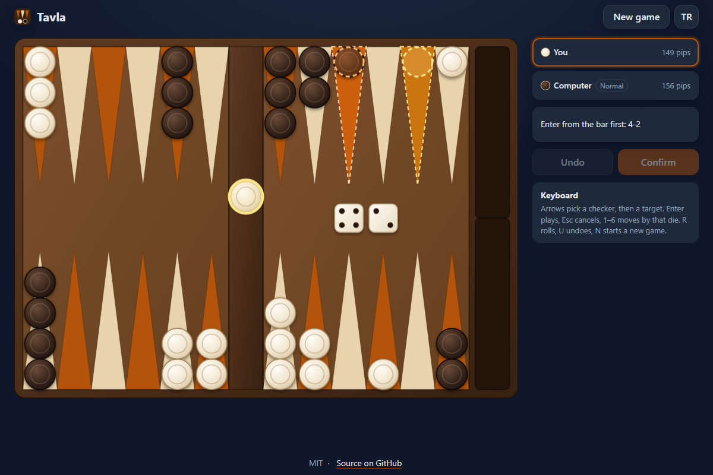

# Tavla - backgammon in the browser against the computer or a friend, by drag or tap

[](#tests)
[](LICENSE)

**▶ Play now: https://celaldrg.github.io/tavla/**



## Features

- The full rules of tavla (backgammon): entering from the bar, hitting blots, blocked points, both dice must be played when possible (the larger one if only one fits), doubles played four times, bearing off, and mars (gammon) counting double.
- Play the computer on **Easy** or **Normal**, or a friend on the same screen.
- Move by dragging a checker, or tap it and then one of the highlighted points. Every step can be undone until you confirm the turn.
- Pip counts for both sides, and the opponent's last move stays marked on the board.
- English and Turkish; the language and game settings are remembered.
- Made for phones too: on a narrow screen the board turns on its side. Full keyboard control on desktop.
- No build step, no dependencies, no network requests: plain HTML, CSS and JavaScript modules.

## How to play

Each side races its 15 checkers around the board into its home board and then bears them off. The first to bear off all 15 wins; if the loser has not borne off any checker yet, it is a mars (gammon) and counts double. You play the light checkers.

**Touch and mouse**

- Press **Roll**, then tap a glowing checker and tap one of the highlighted points, or drag the checker there.
- Tap the chosen checker again to put it back. A checker that is hit goes to the bar and must enter first.
- **Undo** takes back the last step. When every die is played, press **Confirm** (or **Pass** when no move is possible).

**Keyboard**

| Key | Action |
| --- | --- |
| ← → (or ↑ ↓) | Move the cursor over the checkers that can move, then over the targets |
| Enter or Space | Pick the checker under the cursor, play to the target, or press the main button (Roll, Confirm, Pass) |
| 1 to 6 | Move the chosen checker by that die |
| Esc | Put the chosen checker back |
| R | Roll |
| U, Backspace or Ctrl+Z | Undo the last step |
| N | New game (opponent and level) |

Add `?demo` to the address to open a fixed mid-game position.

## Run locally

```sh
npx serve .
```

Then open the address it prints (for example http://localhost:3000). The game uses ES modules, so it has to be served over `http://`; opening `index.html` as a `file://` page does not work. Any static file server will do.

## Tests

```sh
node --test
```

The suites use only `node:test` and `node:assert` (Node.js 22 or newer, nothing to install) and cover the rules, move generation against a brute-force reference, the computer player, the game flow, the board geometry, the texts in both languages, storage and the keyboard mapping. For a coverage report:

```sh
node --test --experimental-test-coverage
```

## Project structure

```text
index.html          page, header, side panel and new-game dialog
style.css           theme, responsive layout and board colours
src/
  board.js          board model, pip counts
  dice.js           seeded random numbers and dice
  rules.js          legal moves, hitting, bearing off, mars
  turn.js           a turn played step by step, with undo
  ai.js             computer player (Easy and Normal)
  game.js           game controller and demo position
  layout.js         board geometry, landscape and portrait
  presenter.js      status line, buttons and highlights from the game state
  i18n.js           English and Turkish texts
  storage.js        localStorage that never throws
  view.js           SVG board and animations
  input.js          pointer and keyboard input
  panel.js          players, status, buttons and dialog
  main.js           entry point that wires it all together
test/               node:test suites
docs/screenshot.png
```

## License

[MIT](LICENSE)

## Türkçe

Tarayıcıda tavla: bilgisayara ya da bir arkadaşına karşı, sürükleyerek ya da dokunarak oyna.

**▶ Hemen oyna: https://celaldrg.github.io/tavla/**

### Özellikler

- Tavlanın bütün kuralları: kırılan pulu bardan oyuna sokma, açık pulu kırma, kapı (iki ya da daha fazla pul olan hane), oynanabiliyorsa iki zarın da oynanması (yalnız biri oynanabiliyorsa büyüğü), çift zarın dört kez oynanması, pulları toplama ve çifte sayılan mars.
- Bilgisayara karşı **Kolay** ya da **Normal** seviyede, ya da aynı ekranda iki kişi.
- Pulu sürükle ya da pula dokunup parlayan hanelerden birine dokun. Turu onaylayana kadar her hamle geri alınabilir.
- İki tarafın pip sayısı görünür, rakibin son hamlesi tahtada işaretli kalır.
- Türkçe ve İngilizce; dil ve oyun ayarları hatırlanır.
- Telefona uygun: dar ekranda tahta yan döner. Masaüstünde baştan sona klavyeyle oynanır.
- Derleme yok, bağımlılık yok, ağ isteği yok: yalnız HTML, CSS ve JavaScript modülleri.

### Nasıl oynanır

İki taraf da 15 pulunu tahtanın çevresinde dolaştırıp kendi evine getirir, sonra toplar. 15 pulunu ilk toplayan kazanır; kaybeden hiç pul toplayamadıysa mars olur ve oyun çifte sayılır. Sen açık renkli pullarla oynarsın.

**Dokunmatik ve fare**

- **Zar at**'a bas, sonra parlayan bir pula ve vurgulanan hanelerden birine dokun ya da pulu oraya sürükle.
- Seçili pula yeniden dokunursan seçim kalkar. Kırılan pul bara gider ve önce o oyuna girmelidir.
- **Geri al** son hamleyi geri alır. Bütün zarlar oynanınca **Onayla**'ya bas (hamle yoksa **Pas geç**).

**Klavye**

| Tuş | İşlev |
| --- | --- |
| ← → (ya da ↑ ↓) | Oynayabilen pullar, sonra hedefler arasında gez |
| Enter ya da Boşluk | İmleçteki pulu seç, hedefe oyna ya da ana düğmeye bas (Zar at, Onayla, Pas geç) |
| 1 - 6 | Seçili pulu o zarla oynat |
| Esc | Seçili pulu bırak |
| R | Zar at |
| U, Backspace ya da Ctrl+Z | Son hamleyi geri al |
| N | Yeni oyun (rakip ve seviye) |

Adresin sonuna `?demo` eklersen sabit bir oyun ortası konumu açılır.

### Yerelde çalıştırma

```sh
npx serve .
```

Sonra yazdığı adresi aç (örneğin http://localhost:3000). Oyun ES modülleri kullanır, bu yüzden `http://` üzerinden sunulmalıdır; `index.html` dosyasını `file://` olarak açmak çalışmaz. Herhangi bir statik dosya sunucusu iş görür.

### Testler

```sh
node --test
```

Testler yalnız `node:test` ve `node:assert` kullanır (Node.js 22 ya da üstü, kurulacak bir şey yok). Kuralları, kaba kuvvetle hesaplanan bir referansa karşı hamle üretimini, bilgisayar oyuncusunu, oyun akışını, tahta geometrisini, iki dildeki metinleri, depolamayı ve klavye eşlemesini kapsar. Kapsama raporu için:

```sh
node --test --experimental-test-coverage
```

### Lisans

[MIT](LICENSE)
